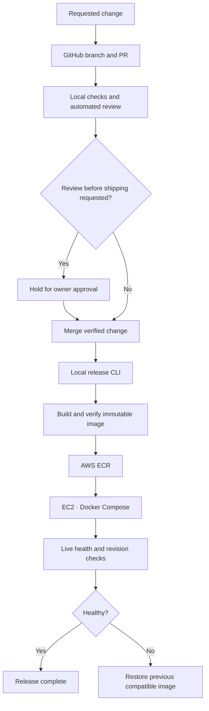

# handh.dev

technology and infrastructure for howeth and harp, bubbas fireworks, and related companies.

## brand

give any agent the full handh.dev brand in under 1k tokens:

```bash
curl -fsSL https://raw.githubusercontent.com/handh-dev/handh-dev/main/brand/AGENTS.md
```

## Website delivery



Bubba Website changes ship by default after successful local verification and automated review. “Let me review it before shipping” holds the change unmerged and undeployed until explicit approval. GitHub stores source and reviews; GitHub Actions is not part of this delivery path.

The project release command is `./project release --environment production`. Other services keep their own release procedures. See the [local SDLC specification](https://github.com/handh-dev/handh-dev/blob/main/docs/local-sdlc.md) for the workflow and measured acceptance.

## repositories

| repo | purpose |
|---|---|
| `handh-infra` | rust operations/tooling, aws, opentofu, docker, and server configuration |
| `handh-website` | howeth and harp public website + hhq |
| `bubbas-mono` | maintained Bubba applications, including Website, Core and HQ, and their release tooling |
| `handh-mail` | mail architecture and operations plan |

## infrastructure

- one aws ec2 server
- docker compose for application services
- postgresql hosted on ec2
- persistent data stored on ebs
- local verification and project-owned CLI deployments
- requested Bubba Website changes ship by default unless the owner explicitly holds shipping
- encrypted offsite backups to s3
- a second in-house backup destination is planned
- product-owned source, including the Bubba monorepo
- frontend and backend stay together when practical

## language standard

rust is required for all non-application services and tooling: cli, operations,
mcp, collectors, dashboards, workstation setup, installers, deployment, backups,
recovery, and secret synchronization. shared implementations and tests live in
the [handh-infra cargo workspace](https://github.com/handh-dev/handh-infra).

application code stays with its product and framework. configuration stays in
its native format: opentofu, compose yaml, caddy, systemd, sql, and workflow yaml.
legacy deployment paths may be symlinks to rust binaries. custom infrastructure
logic belongs in rust. see the [full standard](https://github.com/handh-dev/handh-infra/blob/main/docs/rust-standard.md).

## philosophy

keep the system simple, cheap, portable, and automation-friendly.

important business functionality should be accessible through reusable application logic and APIs rather than existing only inside user interfaces. this keeps the platform ready for future cli, mcp, and ai integrations without building unnecessary infrastructure early.
